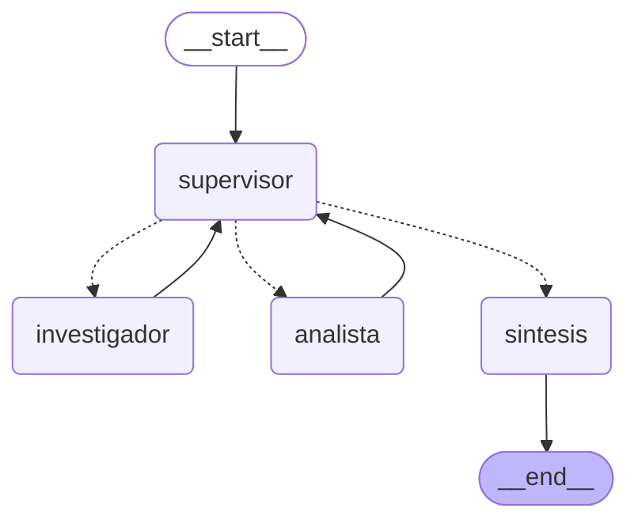

# Orquestador multi-agente de análisis e investigación (LangGraph)

Prototipo de un **orquestador jerárquico**: un **Supervisor** recibe una consulta, decide dinámicamente qué especialista debe intervenir, valida los resultados con una rúbrica y, cuando están completos, pasa a una **síntesis final**.

- **Investigador**: consulta una base de conocimiento (reseñas y fichas de productos de la fintech ficticia BankLab) y devuelve datos crudos con su fuente.
- **Analista**: calcula y analiza esos datos (promedios, sentimiento, costos) con herramientas; no busca información.

## Diagrama del grafo

Generado con `graph.get_graph().draw_mermaid()` (se puede regenerar con `python main.py --graph`). Las flechas punteadas son aristas condicionales.



## Estructura

```
├── state.py                 # Estado compartido (hereda de MessagesState)
├── agents/
│   ├── research_agent.py    # Investigador + herramienta buscar_conocimiento
│   └── analyst_agent.py     # Analista + calcular, estadisticas_basicas, analizar_sentimiento
├── supervisor.py            # Nodo supervisor, rúbrica, frenos duros y arista condicional (Literal)
├── graph.py                 # StateGraph: nodos, aristas, contexto mínimo por especialista
├── data_base.py             # Base de conocimiento simulada (reemplaza Vector DB / Tavily)
├── main.py                  # Demo asíncrona + traza
├── demo_orquestador.ipynb   # Notebook de demostración (Google Colab)
├── traza_orquestacion.json / .log   # Traza de una ejecución real
└── requirements.txt, .env.example, .gitignore
```

## Cómo levantarlo

Requiere Python 3.12.

```bash
py -3.12 -m venv venv
venv\Scripts\activate
pip install -r requirements.txt
copy .env.example .env      # y completá OPENAI_API_KEY (el .env no se sube al repo)
python main.py              # consulta de ejemplo; escribe traza_orquestacion.json/.log
python main.py --pregunta "Compará la Cuenta Sueldo Digital y la Tarjeta Plus"
python main.py --graph      # imprime el diagrama Mermaid
```

## Topología elegida y por qué

**Jerárquica con supervisor central (hub-and-spoke).** Todos los especialistas reportan al supervisor y nunca se hablan entre sí.

- **Un único punto de decisión**: el supervisor es el único que enruta y el único que decide cuándo terminar, así que el flujo es fácil de seguir y de depurar.
- **Especialistas acotados**: cada uno tiene pocas herramientas y un prompt de rol estricto (el investigador no calcula; el analista no busca). Esto reduce confusiones sobre qué herramienta usar.
- **Escalable**: sumar un especialista nuevo implica un nodo, una opción más en el `Literal` del supervisor y una arista de vuelta.
- **Alternativa descartada**: una red donde los agentes se pasan la tarea entre sí. Es más flexible pero mucho más difícil de acotar y de evitar bucles.

### Cómo funciona una ejecución

1. El supervisor lee la consulta y los aportes del equipo y devuelve una **decisión estructurada** (`Decision`, Pydantic): primero completa la rúbrica y después elige `investigador`, `analista` o `FINISH`, con una instrucción autocontenida.
2. Una arista condicional (`route_supervisor`, que retorna `Literal["investigador", "analista", "sintesis"]`) lleva al nodo elegido.
3. El especialista (un agente ReAct de `create_react_agent` con sus herramientas) trabaja y devuelve su aporte al **estado compartido**.
4. Vuelve al supervisor, que decide de nuevo: otro especialista, un refinamiento o `FINISH`.
5. `FINISH` lleva al nodo de **síntesis**, que redacta la respuesta final usando solo los aportes del equipo.

### Estado compartido (`state.py`)

`OrchestratorState` hereda de `MessagesState` y suma `next_agent`, `instruccion`, `pasos`, `task_completed` y dos listas con reducer `operator.add`:

- `contribuciones`: cada aporte firmado con `agente`, `paso`, `instruccion`, `resultado` y `herramientas` usadas. Permite rastrear **qué agente aportó qué**.
- `decisiones`: cada decisión del supervisor con su razón y la evaluación de la rúbrica.

Como las listas se concatenan (no se pisan), ningún nodo pierde lo que escribieron otros.

### Validación (rúbrica del supervisor)

Antes de permitir `FINISH`, el supervisor evalúa tres criterios y los deja registrados en cada decisión:

1. `datos_con_fuente`: los datos vienen de la base e indican fuente o id.
2. `calculos_hechos_por_analista`: todo número derivado fue calculado con herramientas, no inventado.
3. `responde_toda_la_consulta`: están cubiertas todas las partes de la pregunta.

Si un aporte no cumple, el supervisor puede **devolverlo al mismo especialista** con una instrucción concreta de qué corregir (refinamiento).

### Cómo se evitan los errores típicos

- **Supervisor infinito**: dos frenos duros en código, independientes del LLM. `MAX_PASOS = 6` decisiones (al superarlo se cierra con lo disponible, sin consultar al LLM) y `MAX_LLAMADAS_POR_AGENTE = 2` (un especialista no puede refinarse más de 2 veces). Además, `recursion_limit = 25` en el grafo y 12 en cada especialista.
- **Contaminación de contexto**: los especialistas **no ven el historial**. El investigador recibe solo su instrucción; el analista recibe su instrucción más los datos que aportó el investigador. El supervisor ve la consulta y un resumen recortado de los aportes, no los mensajes internos de las herramientas.
- **Conflictos entre agentes**: como los especialistas no se comunican directamente, el conflicto se resuelve en el supervisor. Si un aporte es inconsistente o incompleto, se refina; si el límite se agota, la síntesis lo informa con claridad en lugar de inventar.
- **Cálculos fiables**: el analista no calcula "de cabeza"; usa `calcular` (evaluador aritmético seguro con `ast`, sin `eval`), `estadisticas_basicas` y `analizar_sentimiento`.

## Demostración del flujo de delegación

La consulta de ejemplo exige dos dominios: el supervisor delega primero al investigador (reseñas y costos de la Tarjeta Plus), luego al analista (promedio, sentimiento y costo a 3 años) y finalmente cierra con la síntesis.

Traza completa de una ejecución real en `traza_orquestacion.log` y `traza_orquestacion.json`.

### Resultado de una ejecución real (consulta de ejemplo)

Flujo de delegación: `supervisor -> investigador -> analista -> FINISH -> síntesis`

| Decisión del supervisor | Elige | Rúbrica (fuentes / cálculos por analista / responde todo) | Motivo |
|---|---|---|---|
| 1 | `investigador` | False / False / False | Faltan los datos de la base antes de calcular. |
| 2 | `analista` | True / False / False | Ya hay datos con fuente; faltan promedio, porcentaje positivo y costo a 3 años. |
| 3 | `FINISH` | True / True / True | Datos con fuente, cálculos hechos y consulta completamente respondida. |

Aportes firmados en el estado compartido:

- **Investigador** (herramientas: `buscar_conocimiento` ×2): trajo las 5 reseñas de la Tarjeta Plus (ids `tp-r1` a `tp-r5`, con calificación y fuente) y la ficha oficial de comisiones (`tp-f1`).
- **Analista** (herramientas: `estadisticas_basicas`, `analizar_sentimiento`, `calcular`): calificación promedio **3.8**, **60 %** de reseñas positivas (3 de 5) y costo a 3 años de **$138.000** (12.000 + 3.500 × 36).
- **Síntesis**: recomienda la tarjeta "con precaución": opiniones mixtas (críticas al soporte y a la comisión) y un costo considerable.

Se observa cómo la rúbrica evoluciona: el supervisor no cierra hasta que los tres criterios son verdaderos.

### Demo interactiva (notebook en Google Colab)

[](https://colab.research.google.com/github/TU_USUARIO/ejercicio-6-orquestador-multiagente/blob/main/demo_orquestador.ipynb)

`demo_orquestador.ipynb` muestra el flujo de delegación paso a paso: dibuja el grafo, ejecuta la consulta de ejemplo mostrando cada decisión del supervisor (con su rúbrica) y cada aporte de los especialistas, y resume qué agente usó qué herramientas. Al final permite probar una consulta propia.

Para ejecutarlo en Colab, guardá la clave en *Secretos* (ícono de la llave) con el nombre `OPENAI_API_KEY`; el notebook la lee de ahí y nunca queda escrita en el repositorio.
